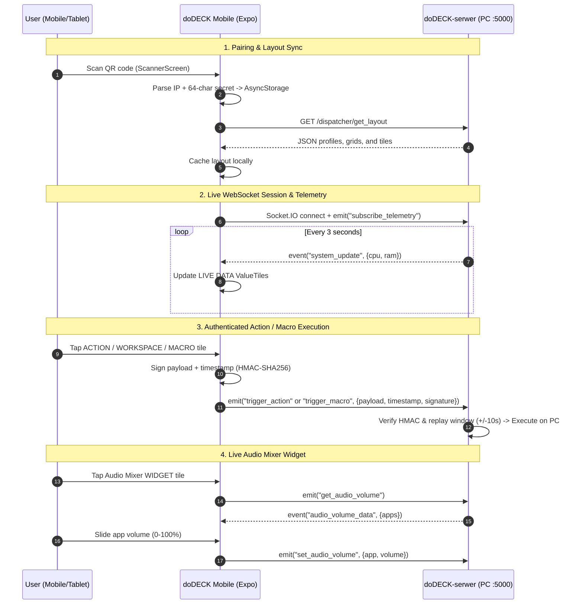

# doDECK Mobile

[](https://expo.dev/)
[](https://reactnative.dev/)
[](https://www.typescriptlang.org/)
[](https://socket.io/)
[](https://jestjs.io/)
[](https://github.com/Dudek03/doDECK-mobile/actions)

**doDECK Mobile** turns any Android or iOS tablet or smartphone into a wireless, customizable macro pad and PC control surface — like a DIY Stream Deck over local Wi-Fi. Built with Expo and React Native, it pairs securely with the companion **[doDECK Server](https://github.com/Dudek03/doDECK-serwer)** via QR code and executes HMAC-SHA256-authenticated shortcuts, multi-step macros, workspace layouts, live hardware telemetry, and per-app Windows audio mixing in real time.

> **Companion Repository:** This mobile client requires **[doDECK-serwer](https://github.com/Dudek03/doDECK-serwer)** running on your Windows PC on the same local network.

---

## Features

- **Dynamic Grid Control Surface:** Landscape-locked, responsive `columns × rows` tile grid fetched from `doDECK-serwer` and cached locally in `AsyncStorage` for instant startup.
- **Six Tile Types:**
  - `ACTION` — Triggers OS hotkeys, text typing, or URL launches.
  - `MACRO` — Executes ordered multi-step command sequences with per-step delays.
  - `WORKSPACE` — Launches, restores, moves, and resizes a saved set of desktop windows.
  - `FOLDER` — Navigates into nested deck profiles with an automatic back-navigation stack.
  - `WIDGET` — Opens interactive widgets such as the real-time per-app **Audio Mixer**.
  - `LIVE DATA` — Streams live PC **CPU** and **RAM** utilization percentages via WebSocket.
- **Zero-Config QR Pairing:** Built-in QR scanner (`expo-camera` + Google Play Services ML Kit native scanner with flashlight toggle) supporting JSON, URL fragment/query, and `dodeck://` URI payloads, plus a manual IP & key fallback in Settings.
- **Cryptographic Command Signing:** Every `trigger_action` and `trigger_macro` Socket.IO event is signed with **HMAC-SHA256** (`crypto-js`) and a Unix timestamp to prevent unauthorized commands and replay attacks.
- **Live Per-App Audio Mixer:** Fetches active Windows audio sessions over WebSocket and adjusts individual application volume sliders (`0–100%`) directly from the tablet.
- **Profile Management:** Switch between server-defined layouts (`Main Panel`, `Tools`, `Media`, or custom grids) right from the Settings screen.

---

## Architecture & Communication Flow

`doDECK Mobile` syncs deck layouts over HTTP (`GET /dispatcher/get_layout`) and maintains a persistent Socket.IO connection (WebSocket with polling fallback, automatic reconnection) to port `5000` on `doDECK-serwer` for low-latency commands, telemetry, and audio control.



---

## Tech Stack

| Layer | Technology |
| :--- | :--- |
| **Framework & Routing** | Expo `58`, React Native `0.88` (New Architecture), Expo Router (file-based navigation) |
| **Language** | TypeScript `6.0`, React `19.3` |
| **Real-Time & HTTP** | `socket.io-client`, `axios` |
| **Security** | `crypto-js` (`HmacSHA256` hex signing) |
| **QR Scanning** | `expo-camera` (CameraView + Google ML Kit native scanner), `patch-package` |
| **Storage & UI** | `@react-native-async-storage/async-storage`, `@react-native-community/slider`, `react-native-safe-area-context` |
| **Native Build Plugins** | Custom Expo Config Plugins (`withMlKitMetadata.js`, `withProguardRules.js`) |
| **Testing & CI** | Jest, `jest-expo`, `@testing-library/react-native`, GitHub Actions (Release APK) |

---

## Project Structure

```text
doDECK-mobile/
├── app/
│   ├── _layout.tsx               # Expo Router Stack (index, SettingsScreen, ScannerScreen)
│   ├── index.tsx                 # Main deck grid, Socket.IO lifecycle, HMAC command signing
│   ├── ScannerScreen.tsx         # QR code scanner (CameraView + ML Kit) & payload parser
│   ├── SettingsScreen.tsx        # Pairing status, layout switcher, manual IP/secret config
│   ├── types.ts                  # Shared TypeScript interfaces (TileItem, LayoutItem, etc.)
│   ├── components/
│   │   ├── ActionTile.tsx        # Pressable tile for ACTION / FOLDER / WORKSPACE / MACRO
│   │   ├── ValueTile.tsx         # Live sensor readout tile (CPU / RAM %)
│   │   ├── WidgetTile.tsx        # Interactive widget launcher tile
│   │   └── VolumeControl.tsx     # Full-screen per-app audio mixer with sliders
│   └── __tests__/                # Jest unit & component tests (6 test suites)
├── assets/
│   ├── fonts/                    # SpaceMono-Regular.ttf
│   ├── images/                   # App icons, adaptive icon, splash screen
│   └── styles/                   # Shared stylesheets (main.js, tileStyles.js, volumeControl.js)
├── plugins/
│   ├── withMlKitMetadata.js      # Injects usesCleartextTraffic & ML Kit barcode metadata
│   └── withProguardRules.js      # Keeps ML Kit / expo-camera classes in release APK builds
├── patches/
│   └── expo-camera+58.0.12.patch # Ensures QR barcode scanning defaults on Android CameraView
├── .github/workflows/build.yml   # CI: Jest tests -> Expo Prebuild -> Gradle Release APK
├── app.json                      # Expo app config (landscape, Android permissions, plugins)
└── package.json                  # Scripts, dependencies, and Jest configuration
```

---

## Getting Started

### Prerequisites

- **Node.js 20+** and **npm**
- **JDK 17** and **Android SDK** (required for native Android builds via `expo run:android` or Gradle)
- **[doDECK-serwer](https://github.com/Dudek03/doDECK-serwer)** running on a Windows PC on the same Wi-Fi/LAN

### Installation

```bash
git clone https://github.com/Dudek03/doDECK-mobile.git
cd doDECK-mobile
npm install
```

> `npm install` automatically runs `patch-package` (`postinstall`) to apply the `expo-camera` QR scanning patch in `patches/`.

### Running Locally

Start the Expo Metro bundler:

```bash
npm start
```

Or build and run natively on a connected device/emulator:

```bash
# Android native development build
npm run android

# iOS native development build (macOS required)
npm run ios

# Web preview
npm run web
```

### Running Tests & Linting

```bash
# Run all Jest unit and component tests
npm test

# Watch mode
npm run test:watch

# Lint code
npm run lint
```

### Building a Release Android APK

Matches the CI pipeline in `.github/workflows/build.yml`:

```bash
npx expo prebuild --platform android --clean
cd android
./gradlew assembleRelease
```

The signed/release APK is generated at `android/app/build/outputs/apk/release/app-release.apk`.

---

## Usage & Pairing

1. Start **[doDECK-serwer](https://github.com/Dudek03/doDECK-serwer)** on your Windows PC and open the Web Editor at `http://localhost:5000/`.
2. Click **Pair** in the Web Editor to display the **Mobile App** QR code.
3. Open **doDECK Mobile** on your tablet or phone:
   - Tap **Settings** in the top-right header.
   - Tap **Scan QR Code from PC** (or use **Open Google Scanner (Recommended)** on Android devices with Google Play Services).
   - Point the camera at the QR code. The app parses the server IP and 64-character HMAC secret and saves them locally.
4. **Supported QR Code Formats:**
   - JSON: `{"ip": "192.168.x.x", "port": 5000, "secret": "<64-char-hex-key>"}`
   - URL: `http://192.168.x.x:5000/#secret=<64-char-hex-key>` (or `?secret=...`)
   - Compact URI: `dodeck://192.168.x.x#<64-char-hex-key>`
5. **Manual Fallback:** If your device lacks a working camera, expand **Advanced Options (Manual IP)** in **Settings** and enter your PC's LAN IP and 64-character secret key manually.
6. Return to the main panel — the connection dot turns green, layouts sync automatically, live CPU/RAM tiles start updating, and all buttons are ready to use.

---

## Related Repositories

- **[doDECK-serwer](https://github.com/Dudek03/doDECK-serwer)** — Companion Python (Flask + Socket.IO) Windows automation server and React drag-and-drop Web Editor.
